# 5. Reproduced results and figures

## Verification result

The public reconstruction produces **24 × 10 = 240** unique region-case rows. Every row satisfies the annual identity within `1e-10 TWh`, every nonzero fossil mix normalizes to one, and every nuclear value agrees with `MW × 8760 × 0.70 / 10^6` within `1.1e-6 TWh`.

Comparison with the immutable historical table gives:

- 232 rows agreeing within workbook rounding;
- 2 confirmed Case 4 source inconsistencies; and
- 6 unresolved source-or-formula inconsistencies in Cases 13–15.

See [QA_SUMMARY.csv](../results/QA_SUMMARY.csv), [verification_240_rows.csv](../results/verification_240_rows.csv), and [source_cell_audit.csv](../results/source_cell_audit.csv).

## National CO2 result

The canonical baseline is **413.415620 Mt CO2/year**. The carbon-only allowance is **64.148259 Mt**, a 84.48% reduction. The carbon-plus-food allowance is **140.691812 Mt**, a 65.97% reduction.

These allowances differ because the carbon-plus-food case assumes large food-related EF reductions outside the electricity calculation, leaving more of the one-Earth budget for carbon.

Tokyo accounts for about 46% of baseline generation CO2 but receives only about 9.3% of the carbon-only national allowance. Hokkaido's carbon-plus-food allowance exceeds its 2016 baseline, so that allocation permits an increase there; it does not represent an achieved regional reduction.

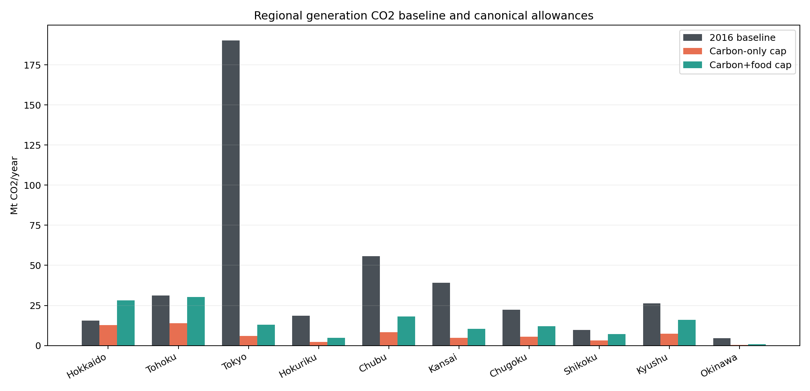

## Biocapacity allocation audit

The visible BC formula reconstructs eight regions. Tokyo and Chubu have equal and opposite differences, which preserve the national total but alter the regional split. The public model therefore uses final-workbook regional caps directly.

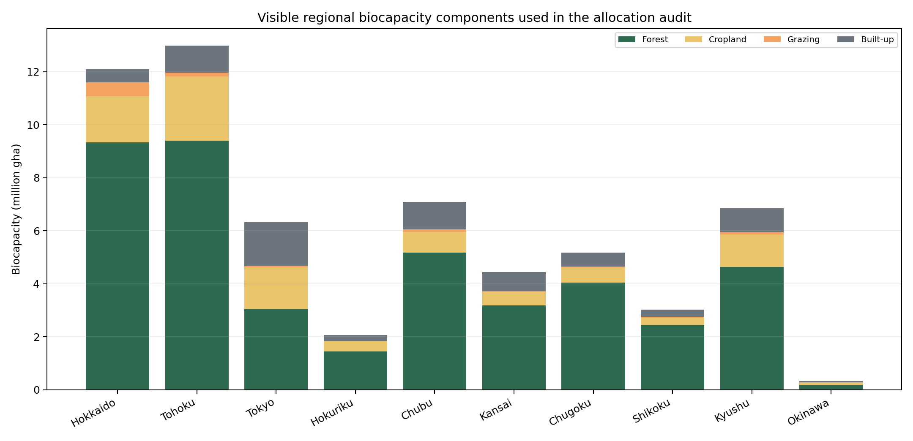

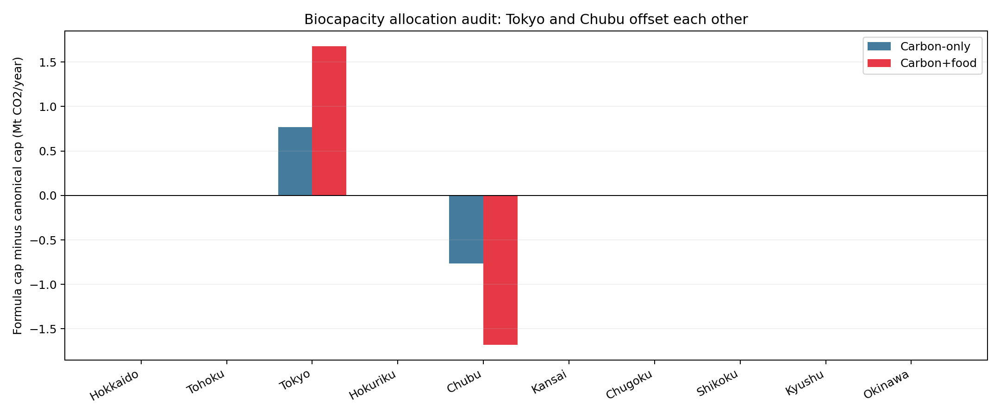

## All 24 national scenario results

The table reports sums across regions. Positive additional RE is the sum of `max(0, regional signed shortfall)` and does not net one region's negative residual against another region's deficit.

| Case | EF | Thermal | Nuclear | Thermal TWh | Nuclear TWh | Gross RE TWh | Positive additional RE TWh |
|---:|---|---|---|---:|---:|---:|---:|
| 1 | carbon only | 2016 | current | 107.819 | 55.985 | 491.808 | 323.313 |
| 2 | carbon only | 2016 | all candidate | 107.819 | 176.412 | 371.382 | 232.404 |
| 3 | carbon only | 2016 | zero | 107.819 | 0 | 547.793 | 379.299 |
| 4 | carbon only | 2030 | current | 103.560 | 55.985 | 496.067 | 332.418 |
| 5 | carbon only | 2030 | all candidate | 103.560 | 176.412 | 375.640 | 240.312 |
| 6 | carbon only | 2030 | zero | 103.560 | 0 | 552.052 | **388.403** |
| 7 | carbon only | LNG only | current | 170.743 | 55.985 | 428.884 | 289.076 |
| 8 | carbon only | LNG only | all candidate | 170.743 | 176.412 | 308.458 | 211.858 |
| 9 | carbon only | LNG only | zero | 170.743 | 0 | 484.869 | 339.997 |
| 10 | carbon only | zero thermal | current | 0 | 55.985 | 599.627 | 429.810 |
| 11 | carbon only | zero thermal | all candidate | 0 | 176.412 | 479.201 | 313.469 |
| 12 | carbon only | zero thermal | zero | 0 | 0 | 655.612 | 485.795 |
| 13 | carbon+food | 2016 | current | 236.471 | 55.985 | 363.156 | 248.694 diagnostic |
| 14 | carbon+food | 2016 | all candidate | 236.471 | 176.412 | 242.729 | 175.158 diagnostic |
| 15 | carbon+food | 2016 | zero | 236.471 | 0 | 419.141 | 290.838 diagnostic |
| 16 | carbon+food | 2030 | current | 227.132 | 55.985 | 372.496 | 264.739 |
| 17 | carbon+food | 2030 | all candidate | 227.132 | 176.412 | 252.069 | 193.260 |
| 18 | carbon+food | 2030 | zero | 227.132 | 0 | 428.481 | 307.035 |
| 19 | carbon+food | LNG only | current | 374.479 | 55.985 | 225.148 | 208.572 |
| 20 | carbon+food | LNG only | all candidate | 374.479 | 176.412 | 104.722 | **148.897** |
| 21 | carbon+food | LNG only | zero | 374.479 | 0 | 281.133 | 233.713 |
| 22 | carbon+food | zero thermal | current | 0 | 55.985 | 599.627 | 429.810 |
| 23 | carbon+food | zero thermal | all candidate | 0 | 176.412 | 479.201 | 313.469 |
| 24 | carbon+food | zero thermal | zero | 0 | 0 | 655.612 | 485.795 |

Cases 13–15 are explicitly marked diagnostic because six regional historical values are unresolved; the reconstructed rows satisfy the stated equations.

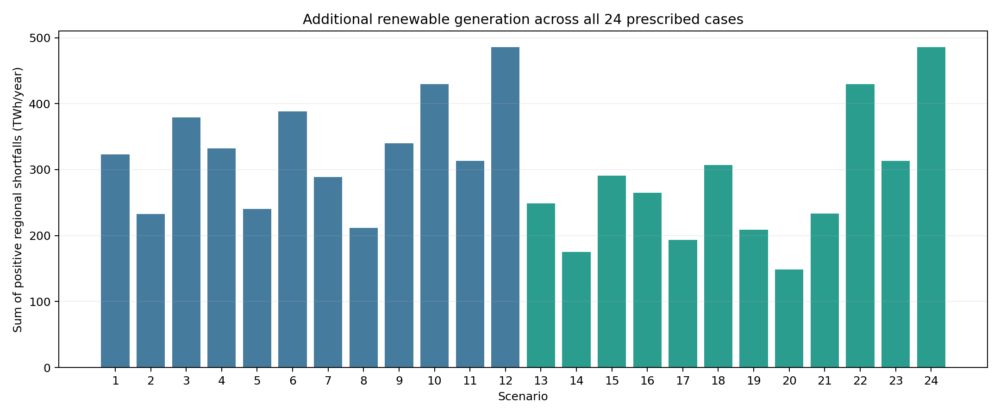

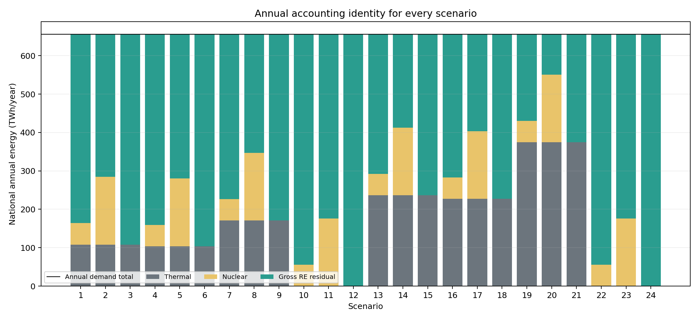

## Why the results change

- The carbon-plus-food case permits more generation CO2 than the carbon-only case, so it permits more fossil energy and generally lowers the renewable residual.
- LNG has the lowest of the three direct combustion factors, so an LNG-only allowance produces more thermal kWh per tonne of allowed CO2.
- More assumed nuclear output directly lowers the gross renewable residual.
- Retiring thermal generation makes the EF case irrelevant to the energy balance; Cases 10–12 and 22–24 therefore match by nuclear case.
- The existing-plus-FIT annual credit lowers the signed shortfall, but it is a direct aggregate input rather than a technology-level reconstruction.

## Case 6 and Case 20

Among cases retaining thermal generation, the thesis identifies Case 6 as the largest and Case 20 as the smallest additional renewable requirement.

| Region | Case 6 gross | Case 6 positive additional | Case 20 gross | Case 20 positive additional | TWh/year |
|---|---:|---:|---:|---:|---|
| Hokkaido | 2.45 | 0 | -64.51 | 0 | annual |
| Tohoku | 39.52 | 9.13 | -30.56 | 0 | annual |
| Tokyo | 190.78 | 158.22 | 149.03 | 116.47 | annual |
| Hokuriku | 24.20 | 14.97 | 3.27 | 0 | annual |
| Chubu | 105.49 | 81.51 | 48.27 | 24.28 | annual |
| Kansai | 87.37 | 64.47 | 27.12 | 4.23 | annual |
| Chugoku | 28.91 | 17.33 | -24.58 | 0 | annual |
| Shikoku | 15.02 | 9.42 | -4.03 | 0 | annual |
| Kyushu | 52.38 | 27.94 | -3.71 | 0 | annual |
| Okinawa | 5.92 | 5.41 | 4.43 | 3.92 | annual |
| **Positive sum** |  | **388.40** |  | **148.90** | annual |

Tokyo Case 6 illustrates the calculation:

`200.378 demand − 9.601 thermal − 0 nuclear = 190.778 gross RE`; then `190.778 − 32.560 credit = 158.218 TWh additional`.

Tokyo Case 20 gives:

`200.378 demand − 34.720 LNG thermal − 16.630 nuclear = 149.028 gross RE`; then `149.028 − 32.560 = 116.468 TWh additional`.

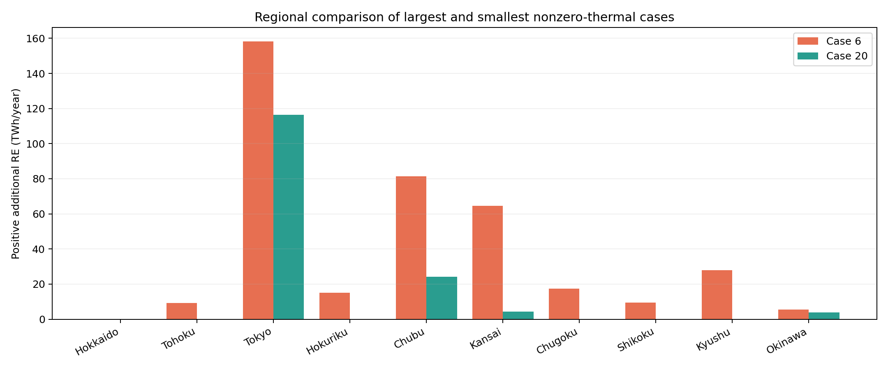

## Regional findings

Tokyo dominates the positive shortfall because it combines the largest demand with a stringent BC-based allowance. Its Case 6 additional need is about 41% of the 388.40 TWh regional positive sum.

Tokyo, Chubu, Kansai, and Okinawa remain positive in every scenario of this annual accounting. Among nonzero-thermal cases, their diagnostic ranges are approximately:

- Tokyo: 116.5–158.2 TWh/year;
- Chubu: 24.3–81.5 TWh/year;
- Kansai: 4.2–64.5 TWh/year;
- Okinawa: 3.9–5.4 TWh/year.

When zero-thermal cases are included, the upper endpoints rise to roughly 167.8, 94.9, 72.1, and 6.0 TWh/year, respectively.

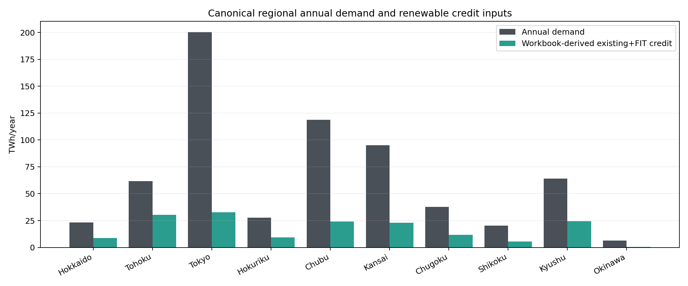

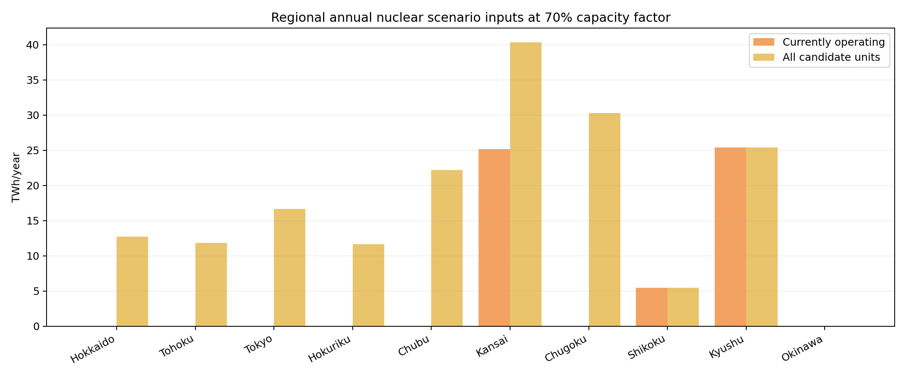

## Zero-thermal cases

With current nuclear, the positive regional shortfall sum is `429.810 TWh`. With all candidate nuclear it is `313.469 TWh`. With zero nuclear it is `485.795 TWh`. These are identical across the two EF cases because the CO2 allowance does not constrain any thermal generation when thermal output is fixed at zero.

## Historical, diagnostic, and unresolved results

### Historical as reported

[as_reported_240.csv](../data/derived/canonical_final_workbook/as_reported_240.csv) preserves the final-workbook-derived numbers and is never overwritten.

### Diagnostic reconstruction

[all_24_scenarios_by_region.csv](../results/all_24_scenarios_by_region.csv) recalculates the annual equations using canonical public configuration and carries the historical comparison columns.

### Case 4 confirmed inconsistency

Hokuriku and Chubu have zero current and zero-nuclear output. Cases 4 and 6 therefore have identical inputs in each region and must have identical reconstructed results. The historical Case 4 cells transfer `9.841287 TWh` from Hokuriku to Chubu while preserving their combined total.

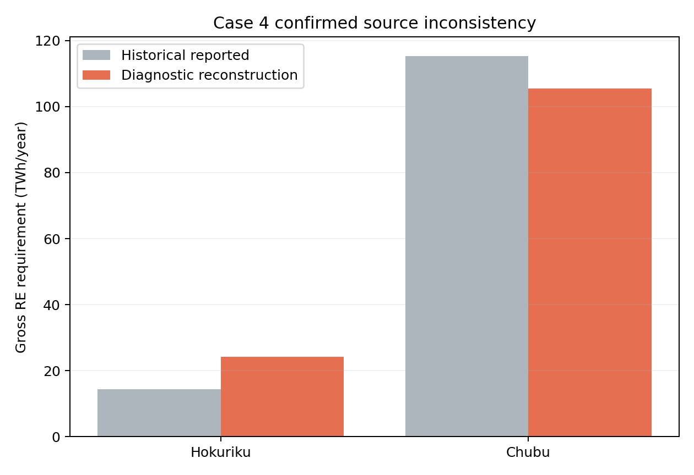

### Cases 13–15 unresolved inconsistency

The six final-workbook source cells are numeric constants, not formulas. Their exact source cells and differences are known, but their original dependency chain is unavailable. They remain `unresolved_source_or_formula_inconsistency` and are not called formula errors.

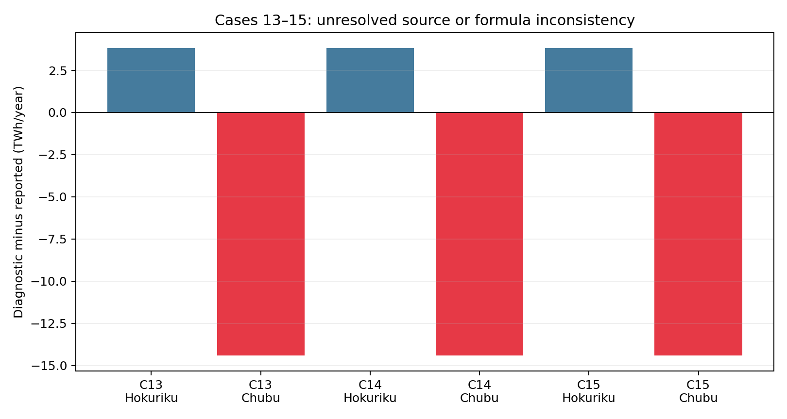

## Source figure audit

The named final presentation contains 18 embedded charts and the conference graph workbook contains 14. [source_figure_audit.csv](../results/source_figure_audit.csv) maps all 32 charts to a reproduced public figure or an evidence limitation. Repeated chart themes are represented once using the canonical public results. Technology-level capacity charts, additional-capacity allocations, and an externally linked sectoral CO2 chart are not independently reproducible from the canonical public input set.

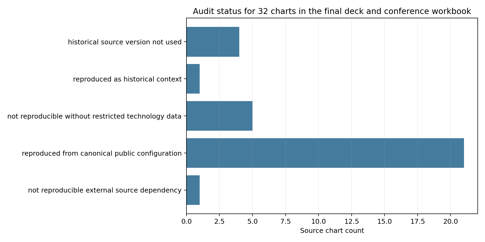

The complete PNG/SVG catalog is [figure_catalog.csv](../results/figure_catalog.csv).
